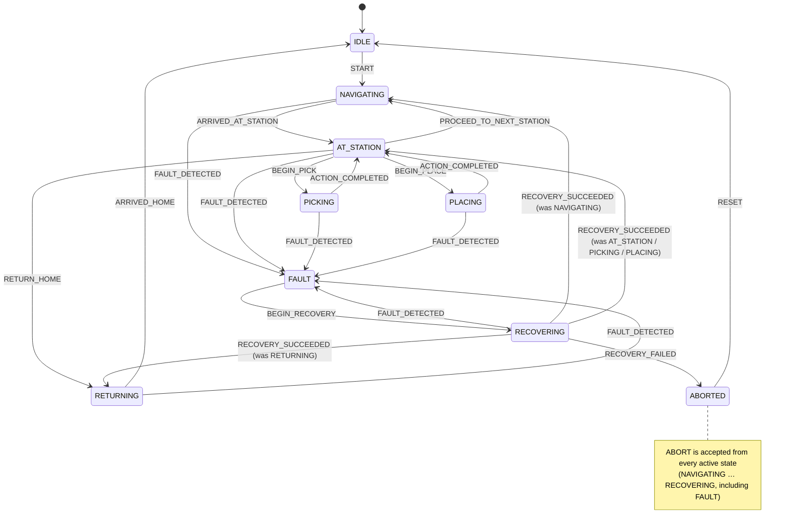

# 01 · Core design (`robot_core`)

`robot_core` is the ROS-free C++17 domain library. It holds the value types,
time abstraction, mission state machine, thread-safe containers and the ports
(interfaces) through which mission logic talks to navigation and manipulation.
It links only the C++ standard library and pthreads; ROS adapters (from v0.2)
depend on it, never the other way round.

## Why the core has no ROS dependency

- **Testability:** every rule is unit tested in milliseconds without a ROS
  graph, DDS discovery, Gazebo or a GPU.
- **Determinism:** time is injected (`IClock`), so timeouts and staleness are
  tested by advancing a `FakeClock`; no test sleeps.
- **Portability:** the same logic can sit behind a different middleware (ROS 2
  Lyrical, rmw_zenoh, a non-ROS fleet tool) without a rewrite.

## Components

| Header | Contents |
| --- | --- |
| `time.hpp` | `RobotTime` tag clock, `Timestamp`, `Duration`, `isFresh()` |
| `clock.hpp` | `IClock`, `SystemClock` (steady), `FakeClock` (manual, thread-safe) |
| `geometry.hpp` | `Pose2D`, `Point2D`, `Vector2D`, `Pose3D`, `Quaternion`, angle helpers |
| `perception_types.hpp` | `ObjectClass`, `BoundingBox2D`, `Detection`, `TrackedObject`, `TrackSource` |
| `manipulation_types.hpp` | `GraspTarget`, `PlaceTarget`, `PickResult`, `PickOutcome` |
| `fault.hpp` | `Fault`, `FaultCode`, `FaultSeverity` |
| `mission.hpp` | `Waypoint`, `MissionLeg`, `StationAction` (variant), `Mission`, `MissionResult`, `validateMission()` |
| `mission_state_machine.hpp` | `MissionStateMachine`, states, events, transition records |
| `task_queue.hpp` | `TaskQueue<T>`: bounded MPMC queue with close semantics |
| `latest_sample.hpp` | `LatestSample<T>`: newest-value-wins slot with sequence numbers and staleness |
| `navigation_client.hpp`, `manipulation_client.hpp` | Ports `INavigationClient`, `IManipulationClient` |
| `mission_executor.hpp` | `MissionExecutor`: tick-driven mission logic over the ports |

## Design decisions

**A dedicated clock tag.** `Timestamp` is `std::chrono::time_point<RobotTime>`,
not `steady_clock::time_point`. Mixing robot time with wall-clock time is then
a compile error. Which source drives robot time (OS steady clock, Gazebo sim
time, a fake) is decided by the injected `IClock`.

**Freshness rejects the future.** `isFresh(stamp, now, max_age)` accepts
`now - max_age <= stamp <= now`. A stamp from the future means producer and
consumer disagree about time, and untrusted data is treated as missing. This
is the primitive behind the safety contract line "perception data older than
300 ms is rejected".

**Plain aggregates for value types.** Rule of zero: no user-declared special
members, public fields, SI units. Invariants are checked by free `isValid()`
functions at trust boundaries (detector output, mission input) instead of
throwing constructors. Learned outputs arrive in exactly these types, and they
must be checkable without exceptions.

**`std::variant` for station actions.** `StationAction =
variant<NoAction, PickAction, PlaceAction>`. Each action carries exactly
the data it needs, `std::visit` forces every alternative to be handled, and
adding an action kind is a compile error everywhere it is not handled yet.

**Enum and table FSM, not a `variant` FSM.** The mission states carry no
per-state data, the states and events are a closed set named by the roadmap,
and safety review wants the legal transitions in one auditable function
(`tableLookup` in `mission_state_machine.cpp`). A `variant`-of-states FSM pays
off when states carry data; here it would scatter the table across visitor
overloads. The test suite holds an independent copy of the table and checks
all 9 × 14 = 126 (state, event) pairs.

**Recovery never resumes mid-motion.** A fault during `PICKING` or `PLACING`
resumes at `AT_STATION`, where the station logic re-evaluates whether the
action is still needed. Navigation and return legs resume as they were, with
the goal re-issued.

**Non-blocking ports.** `INavigationClient` and `IManipulationClient` are
request-then-poll. Their contract: once a request is accepted, `status()`
describes that request (`Running`, or `Idle` until acknowledged), never the
terminal status of the previous one; otherwise the executor would treat a new
goal as already finished. ROS adapters must reset their cached status before
`navigateTo()` or `requestPick()` returns true. That maps directly onto ROS 2 action clients and onto
BehaviorTree.CPP `StatefulActionNode`s (week 3), and keeps `MissionExecutor`
single-threaded and deterministic under test.

**Bounded queue, explicit rejection.** `TaskQueue::push` never blocks and
returns `Accepted`, `Full` or `Closed`. A queue that silently grows is a
latency bug, and a producer that blocks inside a ROS callback stalls an
executor. A rejected item is not consumed: `push(T&&)` moves from its
argument only on `Accepted`, so a move-only work item stays with the caller. `LatestSample` is the right tool for sensor data: the newest frame
replaces the old one, and the sequence number counts drops.

**Interfaces are non-copyable, non-movable.** Polymorphic bases delete copy and
move to prevent slicing. Ownership of concrete implementations stays with the
composition root (the ROS node); the core holds non-owning pointers documented
to outlive it, with no `shared_ptr` out of habit.

## Mission state machine



Every pair not drawn is rejected and leaves the state unchanged. Accepted
transitions are reported with a timestamp to an optional listener, which the
ROS adapter will use to log every transition.

### Mission executor fault policy

| Situation | Response |
| --- | --- |
| Navigation goal fails or is canceled | `NAVIGATION_FAILED` (recoverable) |
| Goal still running after `navigation_timeout` | cancel the goal, `NAVIGATION_TIMEOUT` (recoverable) |
| Pick or place fails | `MANIPULATION_FAILED` with the `PickResult` detail (recoverable) |
| Pick or place exceeds `manipulation_timeout` | cancel the arm, `MANIPULATION_TIMEOUT` (recoverable) |
| A port rejects a request | `COMMAND_REJECTED` (recoverable) |
| External fault, recoverable | stop motion, enter `FAULT` |
| External fault, critical (e.g. `ARM_JOINT_FROZEN`) | stop motion, abort at once, outcome `FAILED` |
| Recovery budget (`max_recovery_attempts` per mission) exhausted | abort, outcome `FAILED` with the last fault |
| Operator abort | stop motion, outcome `CANCELED` |

`MissionExecutor` sequences the mission; it is **not** a safety function.
Speed limiting, stopping and the arm interlock belong to the deterministic
`safety_supervisor` (weeks 3 and 4). From week 3 the BehaviorTree
`mission_manager` takes over orchestration; this executor stays as the tested
reference behaviour and the source of the fault vocabulary.

## Concurrency

- `TaskQueue<T>`: one mutex, one condition variable. Consumers wait on a
  predicate (no lost wake-ups, spurious wake-ups handled), `notify` happens
  after unlocking, and `close()` wakes all waiters.
- `LatestSample<T>`: one mutex. A copy is returned so no reference escapes the
  lock. A mutex rather than a lock-free design because `T` may be a large
  struct and readers are rare (tens of Hz).
- `FakeClock`: a single `std::atomic<int64_t>`. `advance` is a `fetch_add`
  and `setTime` a CAS loop, so concurrent advances are never lost and time
  never goes backwards. Atomics suffice because the state is a single word.
- `MissionStateMachine` and `MissionExecutor` are deliberately single-threaded.
  The ROS adapter calls them from one callback group.

### ThreadSanitizer finding (deliberately injected)

To confirm that TSan catches races in this setup, including the `setarch -R`
workaround below, a copy of `TaskQueue` was built with `size()` reading
`items_.size()` without the lock. That is a plausible bug, since a
diagnostics "queue depth" getter feels harmless. TSan reported:

```
WARNING: ThreadSanitizer: data race
  #0 std::deque<int>::emplace_back      (producer, under the mutex, via push())
  #0 std::deque<int>::size() const      (reader, no lock, via size())
```

`std::deque::size()` reads the iterator pair that `push_back` rewrites, so
the unsynchronised read can return a torn value. The fix (the shipped code)
takes the lock in `size()`. No race was found in the shipped code. The
multi-producer, multi-consumer test passed 1000 consecutive iterations under
TSan with `halt_on_error=1`.

**TSan on WSL2 and recent kernels:** GCC 13's TSan runtime aborts with
`FATAL: ThreadSanitizer: unexpected memory mapping` when the kernel uses high
mmap ASLR entropy (WSL2 6.x, GitHub's Ubuntu 24.04 runners). Three places handle it:

| Where | Fix | Scope |
| --- | --- | --- |
| Local machine | `tools/ci/check_core.sh` runs TSan tests under `setarch "$(uname -m)" -R` | that process tree only |
| GitHub Actions | `sudo sysctl -w vm.mmap_rnd_bits=28` before the TSan job | the disposable runner VM |
| Local container | `ci-tsan` Compose service with `seccomp=unconfined`, because Docker's default seccomp profile refuses `personality(ADDR_NO_RANDOMIZE)` | that container |

The development machine's kernel settings are never changed. Test discovery
runs at `ctest` time (`DISCOVERY_MODE PRE_TEST`), so building the TSan preset
never executes an instrumented binary and needs no wrapper.

### Sanitizer canaries

A sanitizer preset that silently fails to instrument (a typo in a flag, a
cache variable that did not propagate) would still be all green: it would
just be a debug build. Every sanitizer build therefore also builds
`test/sanitizers/sanitizer_canary.cpp`, which contains one deliberate bug per
sanitizer. Its CTest entries pass only if the sanitizer report appears in the
output:

| Preset | Canary | Required report |
| --- | --- | --- |
| `asan` | heap read one past the end | `AddressSanitizer: heap-buffer-overflow` |
| `asan` | `new[]` never freed | `LeakSanitizer: detected memory leaks` |
| `ubsan` | `INT_MAX - 1 + 2` | `runtime error: signed integer overflow` |
| `tsan` | unsynchronised `+=` from two threads | `ThreadSanitizer: data race` |

The canary is never linked into a library and is not compiled in non-sanitizer
presets.

## Review findings (2026-11-07)

A review before finishing v0.1-core found and fixed:

| Finding | Severity | Fix |
| --- | --- | --- |
| `TaskQueue::push(T)` took its argument by value, so a rejected move-only item was destroyed | API defect | `push(const T&)` and `push(T&&)`, consuming only on `Accepted`; tested with `unique_ptr` |
| The GoogleTest download fallback failed at configure time (duplicate `GTest::*` aliases) and activated silently | build defect | opt-in `WMM_FETCH_GTEST`, no duplicate aliases, exercised end to end |
| `MissionExecutor` was implicitly copyable: a copy shares the robot's ports with independent state | ownership | copy and move deleted, with compile-time tests |
| Negative timeouts in `MissionExecutorConfig` made every goal time out at once | input validation | constructor throws `std::invalid_argument`; tested |
| The port contract on stale `status()` after a new request was implicit | API contract | documented on both interfaces; test for an unacknowledged goal |
| `kAllMissionStates` and `kAllMissionEvents` could fall out of sync with the enums, silently shrinking the exhaustive FSM test | test integrity | `static_assert` on their sizes |
| The `LatestSample` concurrency test could check nothing if readers started late | test quality | readers read at least once after the producer finishes; the test asserts reads happened |
| Thread affinity of `MissionExecutor::reportFault()` and listener re-entrancy were undocumented | documentation | documented (single owner thread; listener must not call `handle()`) |

Known limitation: `TaskQueue.CloseWakesBlockedConsumer` cannot force the
consumer to be blocked before `close()` without test hooks. It asserts the
outcome, which holds under both interleavings.

## Dependencies

| Dependency | Source | Pinned by |
| --- | --- | --- |
| GCC 13.3, CMake 3.28, Ninja | Ubuntu 24.04 packages | Docker base image (`ros:jazzy-ros-base-noble`) |
| GoogleTest / GoogleMock 1.14.0 | `libgtest-dev`, `libgmock-dev` (default) | Ubuntu 24.04 |
| GoogleTest 1.14.0, alternative | `-DWMM_FETCH_GTEST=ON`: release archive with SHA256 `8ad598c7…bba5d7` | the hash, verified against two independent downloads |
| clang-format, clang-tidy 18 | `clang-format-18`, `clang-tidy-18` | `check_core.sh` refuses any other major version |
| gcovr 7.0 | Ubuntu 24.04 package | `gcovr.cfg` (filters, 85 % gate) |
| ShellCheck 0.9.0 | Ubuntu 24.04 package | Ubuntu 24.04 |
| GitHub Actions | `actions/checkout` v7.0.1, `upload-artifact` v7.0.2, `docker/setup-buildx-action` v4.4.1, `docker/build-push-action` v7.4.0 | full commit SHAs in the workflow |

Without system GoogleTest and without `WMM_FETCH_GTEST`, configuration stops
with an install hint; nothing is downloaded implicitly.

## Quality gate and CI

`tools/ci/check_core.sh` is the single implementation of every check. The
workflow `.github/workflows/ci.yml` only calls its steps inside the CI image,
so local and CI runs execute the same commands with the same tool versions.

| Step | Checks | CI job and trigger |
| --- | --- | --- |
| `ros-independence` | no ROS include in `src/*_core` | `static-analysis`, every push and PR |
| `format` | clang-format 18 makes no changes | `static-analysis` |
| `shell-lint` | ShellCheck 0.9 on every `*.sh` outside `build/` | `static-analysis` |
| `tidy` | clean build with clang-tidy 18, warnings are errors | `static-analysis` |
| `debug`, `release` | build with `-Werror`, all unit tests | `test` matrix |
| `asan`, `ubsan` | unit tests and canaries under the sanitizer | `test` matrix |
| `tsan` | unit tests, canary, 1000-iteration MPMC stress | `tsan`, nightly and manual |
| `coverage` | gcovr text, Cobertura XML and HTML report; fails below 85 % lines | `coverage`, every push and PR; report uploaded as an artifact |

GPU-free by construction: hosted runners have no GPU, and every test preset
excludes the CTest label `gpu`. GPU-dependent tests (from week 2) must carry
that label, live in separate test executables, and run only through
`ctest --preset gpu` on the RTX machine. The CI image contains no CUDA.

### Reproducing CI locally

Natively on Ubuntu 24.04, with the packages from `docker/install_toolchain.sh`:

```bash
tools/ci/check_core.sh all              # every step, in CI order
tools/ci/check_core.sh asan coverage    # selected steps
tools/ci/check_core.sh --fix-format format
```

In the exact CI image (Docker with WSL integration enabled):

```bash
docker compose --profile ci build ci
docker compose --profile ci run --rm ci tools/ci/check_core.sh \
  ros-independence format shell-lint tidy debug release asan ubsan coverage
docker compose --profile ci run --rm ci-tsan tools/ci/check_core.sh tsan
```

CMake caches record their absolute source path, so a tree configured on the
host (`/mnt/d/...`) is rejected at `/ws` ("CMakeCache.txt directory ... is
different"). The Compose services therefore overlay `/ws/build` with their own
host directory: `build/docker-ci` for `ci` and `ci-tsan`, `build/docker-dev`
for `dev`. Host and container builds live side by side, and the coverage report
of a container run is at `build/docker-ci/coverage/report/`. The services run as
`HOST_UID:HOST_GID` (default 1000:1000); other UIDs set both variables, because
Bash's `$UID` is read-only and not exported.

CI additionally runs the container as the runner's UID
(`-u "$(id -u):$(id -g)"`), so build files on the bind mount stay owned by the
invoking user. The image holds only the toolchain; the source is mounted, so
editing code never invalidates the image cache.

## Measurements (v0.1-core)

Measured locally on 2026-11-07 (WSL2 Ubuntu 24.04, GCC 13.3, 12 threads),
from an empty `build/` directory:

| Metric | Value |
| --- | --- |
| Unit test cases (CTest entries) | 237, of which 126 are the exhaustive FSM table |
| Sanitizer canaries | 4 / 4 detected (ASan 2, UBSan 1, TSan 1) |
| clang-tidy warnings | 0 (clean build, `--warnings-as-errors=*`) |
| Presets | debug, release, ASan+LSan, UBSan, TSan: all green |
| TSan stress | `TaskQueue` MPMC test, 1000 / 1000 iterations, 0 reports |
| Line coverage (gcovr 7.0, `src/*_core`) | 98.2 % (642 / 654 lines); branches 89.7 % (468 / 522); gate 85 % |
| ShellCheck 0.9.0 | 0 findings (2 scripts) |
| Full local gate except coverage (`check_core.sh`, sources on `/mnt/d`) | 4 min 9 s |
| Coverage step alone, host | 3 min 17 s |

In the CI image (Docker Desktop 29.9.2 with WSL integration, same machine,
empty `build/docker-ci`):

| Metric | Value |
| --- | --- |
| `docker compose build` of `wmm-ci` and `wmm-dev` (in parallel, cold) | 1 min 22 s each; 1.75 GB each |
| Toolchain in both images | GCC 13.3.0, CMake 3.28.3, clang-format/clang-tidy 18.1.3, gcovr 7.0, ShellCheck 0.9.0 |
| `ci`: ros-independence, format, shell-lint, tidy, debug, release, asan, ubsan, coverage | all green in 7 min 3 s; CTest 237 / 237 / 239 / 238 (debug / release / ASan / UBSan); coverage 98.2 % lines |
| `ci-tsan`: tsan step plus 1000-iteration `TaskQueue.MultiProducer*` stress | 238 / 238 and 1000 / 1000, 0 TSan reports, 52 s |
| `ci.yml`-style `docker run -u "$(id -u):$(id -g)"` on a fresh copy without `build/` | static steps and debug green |
| `wmm-dev` without GPU (core debug build) | 237 / 237 as user `dev` |
| `wmm-dev` with GPU (`compose --profile dev`) | not verified: WSL has `/dev/dxg` but no NVIDIA user-space libraries (`libcuda.so`, `nvidia-smi`), so `nvidia-container-cli` reports "no adapters were found" |
